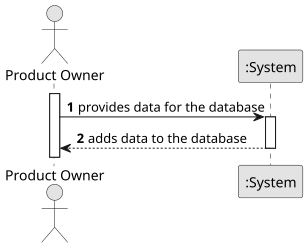

# USBD04 - Insert Data into Database

## 1. Requirements Engineering

### 1.1. User Story Description

As a Product Owner, I want to insert the provided data into the new database generated in USBD03.

### 1.2. Customer Specifications and Clarifications 

**From the specifications document:**

>	There are no specifications from the document or the customer.

### 1.3. Acceptance Criteria

* **AC1**: The insert instructions must be well formatted.

### 1.4. Found out Dependencies

* There is a dependency on "USBD03 - Instantiate Relational Model" as the provided data must be inserted into the instantiated database.

### 1.5 Input and Output Data

**Input Data:**

* The instantiated database
* The data

**Output Data:**

* The data added into the database

### 1.6. System Sequence Diagram (SSD)

**_Other alternatives might exist._**

### 1.7 Other Relevant Remarks

* 