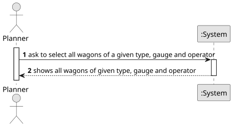

# USDB12 - List all wagons of a given type and gauge belonging to an operator

## 1. Requirements Engineering

### 1.1. User Story Description

As a planner, I want a list of all wagons of a given type and gauge that belong to a given operator.

### 1.2. Customer Specifications and Clarifications 

**From the specifications document:**

>   There are no specifications from the document or the customer.  

### 1.3. Acceptance Criteria

* **AC1:** The wagon type, gauge and the operator must exist in the database.

### 1.4. Found out Dependencies

* There is a dependency on "USBD03 - Instantiate Relational Model" as there must be a database to add the data.
* There is a dependency on "USBD04 - Insert into Database" as there must be valid data to return.

### 1.5 Input and Output Data

**Input Data:**

* Wagon type
* Wagon gauge
* Wagon operators ID

**Output Data:**

* List of all wagons with the provided type, gauge and operator

### 1.6. System Sequence Diagram (SSD)

**_Other alternatives might exist._**

### 1.7 Other Relevant Remarks

* 