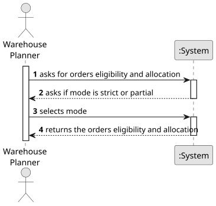

# USEI02 - Order Eligibility & Allocation

## 1. Requirements Engineering

### 1.1. User Story Description

As a warehouse planner, when I receive open orders, I want the system to examine current inventory and allocate quantities from boxes in FEFO order, and produce per-line statuses (ELIGIBLE, PARTIAL, UNDISPATCHABLE) and a list of allocation rows with box and bay information.

### 1.2. Customer Specifications and Clarifications 

**From the specifications document:**

>   A warehouse planner must fulfill the orders it receives. To achieve
this, he needs to verify from the inventory which order lines can be dispatched and,
for those, allocate concrete quantities from boxes using FEFO rules. The outcome
is a list of per-line statuses and a set of concrete allocation rows (per order,line,box)
for dispatch planning.

**From the client clarifications:**

### 1.3. Acceptance Criteria

* **AC1:** Orders are processed by: priority ASC, dueDate ASC, orderId ASC.
* **AC2:** Within an order, lines are processed by lineNo ASC (input order).
* **AC3:** For each line, allocation walks the SKU’s boxes in FEFO/FIFO order.
* **AC4:** For each visited bay, allocate take min(remainingQty, box.qtyAvailable), reduce remainingQty, and continue until the request is satisfied or boxes end.
* **AC5:** The available box quantity never goes below zero during planning.
* **AC6:** The system supports two modes: flag eligibility strict, partial, the default is strict.

### 1.4. Found out Dependencies

### 1.5 Input and Output Data

**Input Data:**

* The CSV files with the required data.
	
**Output Data:**

* A list of orders eligibility with: orderId, lineNo, sku, requestedQty, allocatedQty, status;
* Output allocations (one row per allocation fragment): orderId, lineNo, sku,
qty, boxId, aisle, bay.

### 1.6. System Sequence Diagram (SSD)

### 1.7 Other Relevant Remarks